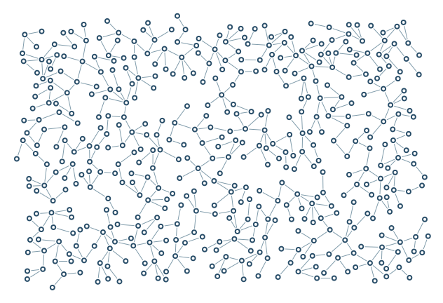

# Angles / unrestricted

No hard or soft angle rule: more acute junctions can survive.

```console
python -m examples.angles_free.example
python -m scripts.generate_examples angles_free --seed 19 --nodes 120
```

The default uses seed 7 and the Porcelain palette. The library recipe is defined in `src/samples.py`; the Python entry point calls that same factory so CLI and Python results stay consistent. Edit the returned graph before building to explore settings.

- `minimum=0`: Hard lower bound on the smaller incident angle, in degrees.
- `preferred=0`: Soft preferred incident angle, in degrees.
- `penalty=0`: Probability-reduction strength below the preferred angle, from 0 to 1.

`output/figure.png` and `output/figure.svg` show the same geometry. `output/results.json` records the seed, requested/achieved nodes, edges, stop reason, validation and timing. Large country and panorama recipes can take several minutes; `--nodes 120` is a smoke check, not a representative final composition.

Limit: Collision checks still forbid overlapping strokes.



[Example index](../README.md) | [User guide](../../docs/guide/index.html)
