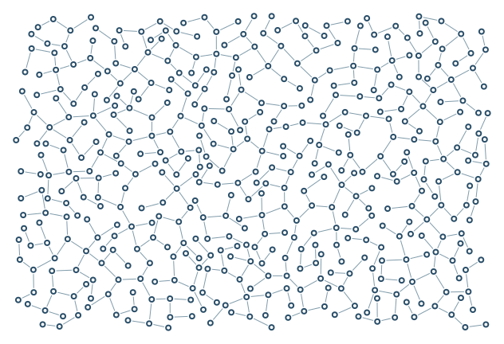

# Angles / strict junctions

Combine a 60-degree ban with a 90-degree preference.

```console
python -m examples.angles_strict.example
python -m scripts.generate_examples angles_strict --seed 19 --nodes 120
```

The default uses seed 7 and the Porcelain palette. The library recipe is defined in `src/samples.py`; the Python entry point calls that same factory so CLI and Python results stay consistent. Edit the returned graph before building to explore settings.

- `minimum=60`: Hard lower bound on the smaller incident angle, in degrees.
- `preferred=90`: Soft preferred incident angle, in degrees.
- `penalty=0.9`: Probability-reduction strength below the preferred angle, from 0 to 1.

`output/figure.png` and `output/figure.svg` show the same geometry. `output/results.json` records the seed, requested/achieved nodes, edges, stop reason, validation and timing. Large country and panorama recipes can take several minutes; `--nodes 120` is a smoke check, not a representative final composition.

Limit: Stricter controls may leave more open space.



[Example index](../README.md) | [User guide](../../docs/guide/index.html)
