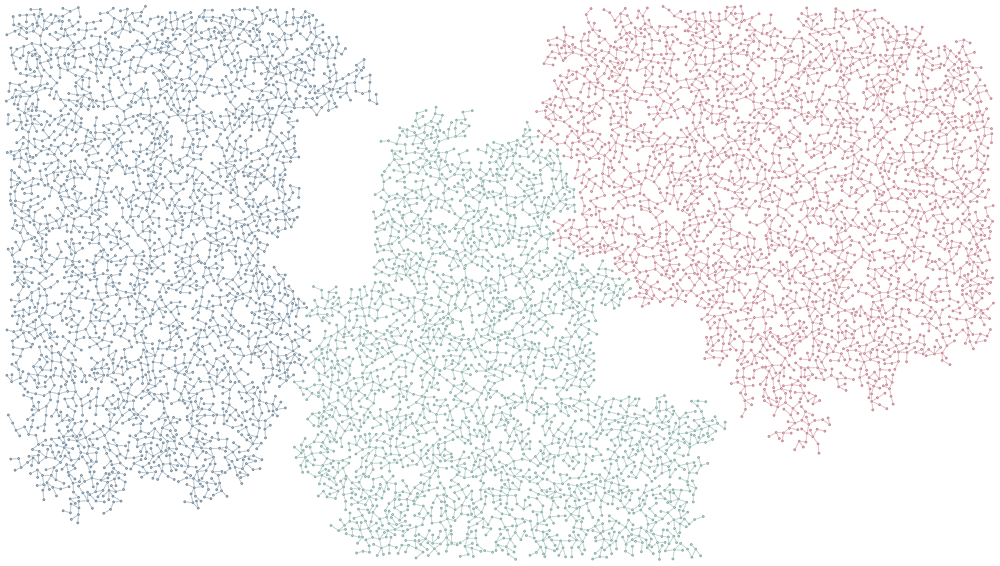

# Territorial archipelago / large

Three colonies claim a large canvas around obstacle islands with hard rival gaps.

```console
python -m examples.archipelago.example
python -m scripts.generate_examples archipelago --seed 19 --nodes 120
```

The default uses seed 7 and the Porcelain palette. The library recipe is defined in `src/samples.py`; the Python entry point calls that same factory so CLI and Python results stay consistent. Edit the returned graph before building to explore settings.

- `target_nodes=8000`: Requested population, including seeds; constraints can prevent it.
- `three colonies`: Three independently owned seed groups share the region.
- `pairwise clearance`: Separate hard exclusion distances for each colony pair.

`output/figure.png` and `output/figure.svg` show the same geometry. `output/results.json` records the seed, requested/achieved nodes, edges, stop reason, validation and timing. Large country and panorama recipes can take several minutes; `--nodes 120` is a smoke check, not a representative final composition.

Limit: This is spatial competition, not resource consumption or biological survival.



[Example index](../README.md) | [User guide](../../docs/guide/index.html)
