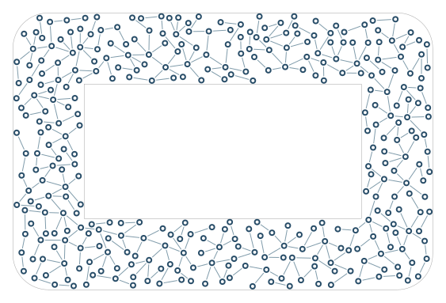

# Contour band

Grow within a finite-width band around a supplied polygon.

```console
python -m examples.band.example
python -m scripts.generate_examples band --seed 19 --nodes 120
```

The default uses seed 7 and the Porcelain palette. The library recipe is defined in `src/samples.py`; the Python entry point calls that same factory so CLI and Python results stay consistent. Edit the returned graph before building to explore settings.

- `RegionSpec.mode=band`: Inside, outside or a finite-width band around a contour.
- `band_width`: Full width of the permitted boundary band.
- `padding`: Inset or offset that reserves whitespace around the boundary.

`output/figure.png` and `output/figure.svg` show the same geometry. `output/results.json` records the seed, requested/achieved nodes, edges, stop reason, validation and timing. Large country and panorama recipes can take several minutes; `--nodes 120` is a smoke check, not a representative final composition.

Limit: This uses supplied polygons. Glyph regions are supported through Text; importing arbitrary SVG paths remains separate.



[Example index](../README.md) | [User guide](../../docs/guide/index.html)
