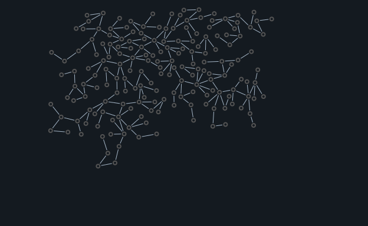

# Historical graph

Builds the original dark network style with seed 7. PNG and SVG are written under output/.

```console
python -m examples.basic_graph.example
```

Edit the graph settings in `example.py` before building. Requested nodes may not all fit; these examples preserve the existing hand-written compositions. The runner executes these with their fixed settings.

[Example index](../README.md)


