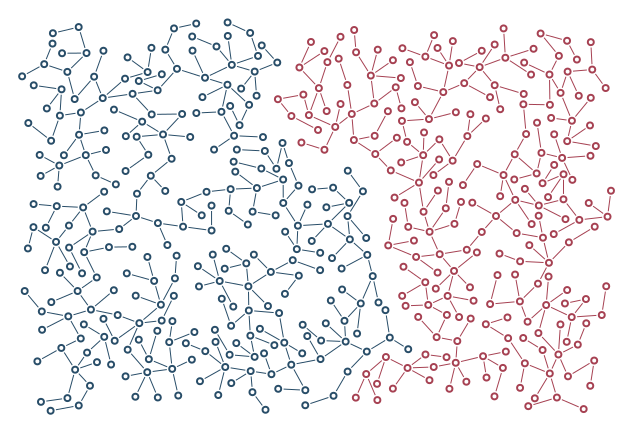

# Repulsion and hard separation

Colony headings turn away while an explicit rival gap separates rings and full strokes.

```console
python -m examples.compete.example
python -m scripts.generate_examples compete --seed 19 --nodes 120
```

The default uses seed 7 and the Porcelain palette. The library recipe is defined in `src/samples.py`; the Python entry point calls that same factory so CLI and Python results stay consistent. Edit the returned graph before building to explore settings.

- `Interaction.attraction=-0.3`: Signed steering: negative repels, positive attracts.
- `clearance=10`: Hard minimum separation between rival visible geometry.
- `Colony.weight`: Relative share of growth attempts, not guaranteed territory.

`output/figure.png` and `output/figure.svg` show the same geometry. `output/results.json` records the seed, requested/achieved nodes, edges, stop reason, validation and timing. Large country and panorama recipes can take several minutes; `--nodes 120` is a smoke check, not a representative final composition.

Limit: Repulsion alone does not guarantee clearance; weights grant attempts, not area.



[Example index](../README.md) | [User guide](../../docs/guide/index.html)
