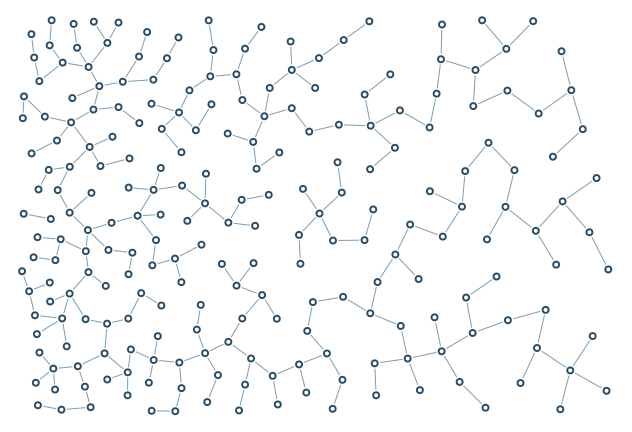

# Density gradient

Desired population and spacing vary smoothly from dense left to sparse right.

```console
python -m examples.density.example
python -m scripts.generate_examples density --seed 19 --nodes 120
```

The default uses seed 7 and the Porcelain palette. The library recipe is defined in `src/samples.py`; the Python entry point calls that same factory so CLI and Python results stay consistent. Edit the returned graph before building to explore settings.

- `SpatialFields.density`: Requested nodes per square world unit, converted to preferred spacing.
- `CoverageSettings`: Bias generation toward underfilled cells with finite reseeding.
- `spacing_limits`: Minimum and maximum preferred centre spacing from density.

`output/figure.png` and `output/figure.svg` show the same geometry. `output/results.json` records the seed, requested/achieved nodes, edges, stop reason, validation and timing. Large country and panorama recipes can take several minutes; `--nodes 120` is a smoke check, not a representative final composition.

Limit: Density is in nodes per square world unit and remains a packing heuristic.



[Example index](../README.md) | [User guide](../../docs/guide/index.html)
