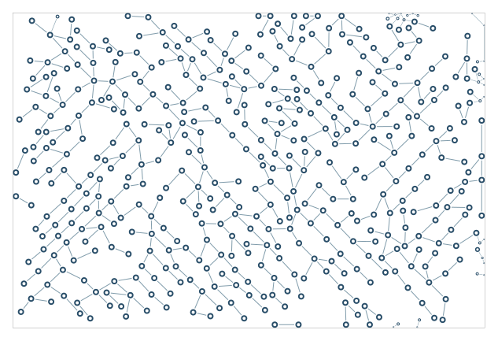

# Boundary following experiment

Bias growth along a boundary while retaining interior branches.

```console
python -m examples.follow.example
python -m scripts.generate_examples follow --seed 19 --nodes 120
```

The default uses seed 7 and the Porcelain palette. The library recipe is defined in `src/samples.py`; the Python entry point calls that same factory so CLI and Python results stay consistent. Edit the returned graph before building to explore settings.

- `ContourSettings.mode=follow`: Contain, follow tangents, or aim terminal nodes at anchors.
- `boundary_fraction`: Fraction of proposals receiving boundary guidance.
- `guidance`: Strength of the contour direction bias.

`output/figure.png` and `output/figure.svg` show the same geometry. `output/results.json` records the seed, requested/achieved nodes, edges, stop reason, validation and timing. Large country and panorama recipes can take several minutes; `--nodes 120` is a smoke check, not a representative final composition.

Limit: Experimental: gaps can remain and a closed boundary loop is not promised.



[Example index](../README.md) | [User guide](../../docs/guide/index.html)
