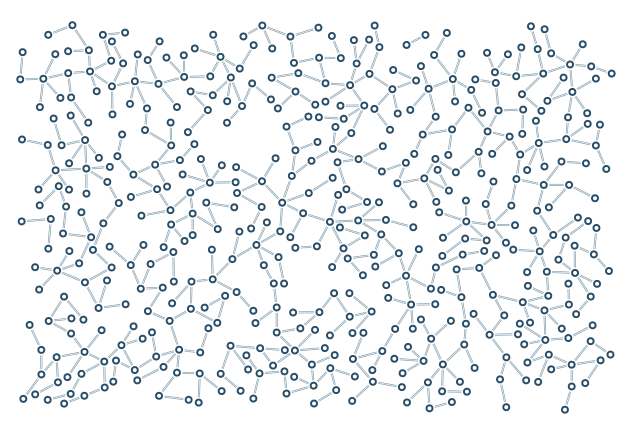

# Double connections

Parallel strokes share a single reserved full-width corridor.

```console
python -m examples.lines.example
python -m scripts.generate_examples lines --seed 19 --nodes 120
```

The default uses seed 7 and the Porcelain palette. The library recipe is defined in `src/samples.py`; the Python entry point calls that same factory so CLI and Python results stay consistent. Edit the returned graph before building to explore settings.

- `edge_style=double`: Solid, dashed, dotted or double strokes in one protected corridor.
- `edge_thickness=2`: Full reserved stroke width; double lines use one third per stroke.

`output/figure.png` and `output/figure.svg` show the same geometry. `output/results.json` records the seed, requested/achieved nodes, edges, stop reason, validation and timing. Large country and panorama recipes can take several minutes; `--nodes 120` is a smoke check, not a representative final composition.

Limit: Style changes do not open gaps in collision protection.



[Example index](../README.md) | [User guide](../../docs/guide/index.html)
