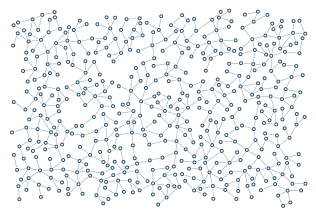

# Controlled cycles

Additional short edges close existing components after branch growth.

```console
python -m examples.loops.example
python -m scripts.generate_examples loops --seed 19 --nodes 120
```

The default uses seed 7 and the Porcelain palette. The library recipe is defined in `src/samples.py`; the Python entry point calls that same factory so CLI and Python results stay consistent. Edit the returned graph before building to explore settings.

- `target_extra_edges`: Requested extra connections after branching to create cycles.
- `max_degree`: Maximum incident edges at a node.
- `loop_distance`: Search radius for possible extra connections.

`output/figure.png` and `output/figure.svg` show the same geometry. `output/results.json` records the seed, requested/achieved nodes, edges, stop reason, validation and timing. Large country and panorama recipes can take several minutes; `--nodes 120` is a smoke check, not a representative final composition.

Limit: Every loop must still pass collision, degree, and both-endpoint angle checks.



[Example index](../README.md) | [User guide](../../docs/guide/index.html)
