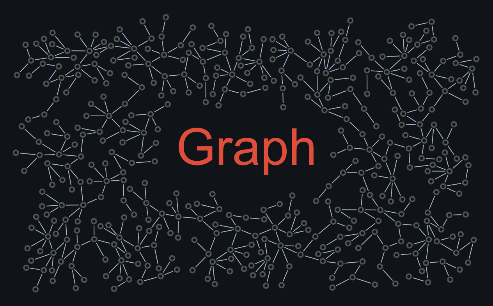

# Name composition

A measured text rectangle excludes growth; size, alignment and padding_em control the reserved area. Writes output/figure.png.

```console
python -m examples.name_composition.example
```

Edit the graph settings in `example.py` before building. Requested nodes may not all fit; these examples preserve the existing hand-written compositions. The runner executes these with their fixed settings.

[Example index](../README.md)


