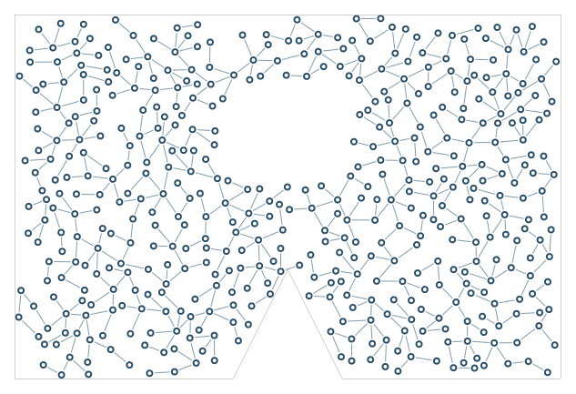

# Irregular region and exclusions

Full nodes and strokes stay inside a concave outline and outside an internal obstacle.

```console
python -m examples.obstacles.example
python -m scripts.generate_examples obstacles --seed 19 --nodes 120
```

The default uses seed 7 and the Porcelain palette. The library recipe is defined in `src/samples.py`; the Python entry point calls that same factory so CLI and Python results stay consistent. Edit the returned graph before building to explore settings.

- `outline_polygon`: Allowed shape; full node disks and edge strokes must fit.
- `illegal_areas`: Additional polygon obstacles that block visible geometry.
- `draw_border`: Draw the supplied outline, independently of growth.

`output/figure.png` and `output/figure.svg` show the same geometry. `output/results.json` records the seed, requested/achieved nodes, edges, stop reason, validation and timing. Large country and panorama recipes can take several minutes; `--nodes 120` is a smoke check, not a representative final composition.

Limit: Exact containment does not imply every narrow pocket will be filled.



[Example index](../README.md) | [User guide](../../docs/guide/index.html)
