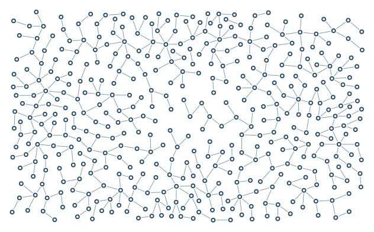

# Painted Density

A coarse painted mask creates bands of dense and open texture. Any scalar measurement can play this role.

```console
python -m examples.painted_density.example
python -m scripts.generate_examples painted_density --seed 19 --nodes 120
```

Edit `config.yaml` to explore the illustrated setting. `config.json` is the equivalent starting configuration; both use the same scene schema. Coordinates are `[x, y]` in world units. The Python example reads the adjacent YAML file, resolves relative inputs there, and accepts an optional seed or node-cap override.

Outputs: `output/figure.png`, `output/figure.svg`, and `output/results.json` with achieved counts, growth status and validation. The configured node count is a cap; tight contours, large rings and hard angle rules can leave gaps. Font availability affects text contours.



[Scene schema](../../scripts/site_content/SCENES.md) | [Example index](../README.md)
