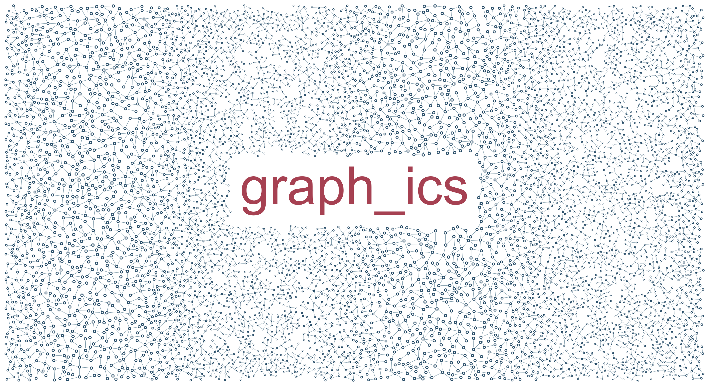

# Panoramic network / large

A wide network with a coordinated wave in scale and a central title.

```console
python -m examples.panorama.example
python -m scripts.generate_examples panorama --seed 19 --nodes 120
```

The default uses seed 7 and the Porcelain palette. The library recipe is defined in `src/samples.py`; the Python entry point calls that same factory so CLI and Python results stay consistent. Edit the returned graph before building to explore settings.

- `target_nodes=7000`: Requested population, including seeds; constraints can prevent it.
- `coordinated_scale`: Position-dependent scaling of all geometry dimensions.
- `output dimensions`: World frame times export scale, including margins.

`output/figure.png` and `output/figure.svg` show the same geometry. `output/results.json` records the seed, requested/achieved nodes, edges, stop reason, validation and timing. Large country and panorama recipes can take several minutes; `--nodes 120` is a smoke check, not a representative final composition.

Limit: A high node target may still leave local gaps.



[Example index](../README.md) | [User guide](../../docs/guide/index.html)
