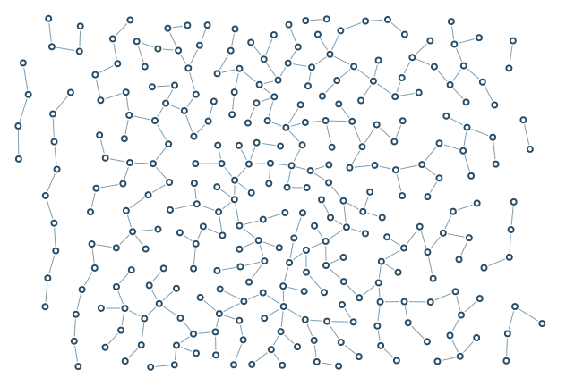

# Image density map

A small scalar image creates a dense central band using world-coordinate bilinear interpolation.

```console
python -m examples.raster.example
python -m scripts.generate_examples raster --seed 19 --nodes 120
```

The default uses seed 7 and the Porcelain palette. The library recipe is defined in `src/samples.py`; the Python entry point calls that same factory so CLI and Python results stay consistent. Edit the returned graph before building to explore settings.

- `ImageField.pixels`: Scalar raster values sampled by bilinear interpolation.
- `ImageField.bounds`: World rectangle mapping the first and last pixel centres.
- `ImageField.outside`: Clamp, return a constant, or error outside the raster.

`output/figure.png` and `output/figure.svg` show the same geometry. `output/results.json` records the seed, requested/achieved nodes, edges, stop reason, validation and timing. Large country and panorama recipes can take several minutes; `--nodes 120` is a smoke check, not a representative final composition.

Limit: Row zero maps to minimum y; a lower-resolution raster smooths small features.



[Example index](../README.md) | [User guide](../../docs/guide/index.html)
