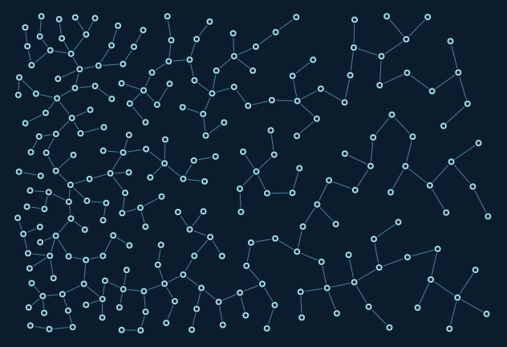

# Factory and event log

Uses the density recipe, seed 7, Arctic palette, and records growth.jsonl alongside PNG/SVG figures in output/.

```console
python -m examples.sample_library.example
```

Edit the graph settings in `example.py` before building. Requested nodes may not all fit; these examples preserve the existing hand-written compositions. The runner executes these with their fixed settings.

[Example index](../README.md)


