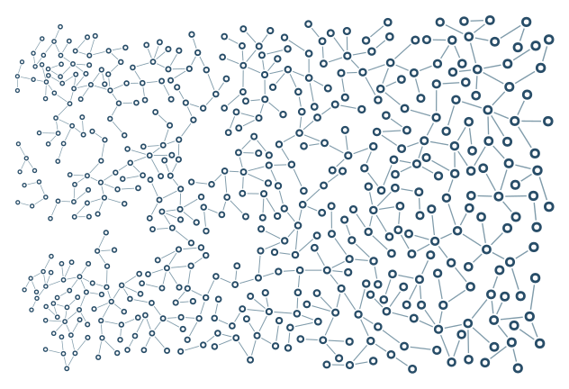

# Coordinated sizes

Rings, gaps, buffers, lengths, and stroke widths grow together across the canvas.

```console
python -m examples.scale.example
python -m scripts.generate_examples scale --seed 19 --nodes 120
```

The default uses seed 7 and the Porcelain palette. The library recipe is defined in `src/samples.py`; the Python entry point calls that same factory so CLI and Python results stay consistent. Edit the returned graph before building to explore settings.

- `SpatialFields.coordinated_scale`: Scale radii, lengths, gaps and stroke widths together.
- `scale_limits`: Clamp local geometry multipliers to a positive interval.
- `ring_ratio`: Inner radius divided by outer radius; controls the hollow centre.

`output/figure.png` and `output/figure.svg` show the same geometry. `output/results.json` records the seed, requested/achieved nodes, edges, stop reason, validation and timing. Large country and panorama recipes can take several minutes; `--nodes 120` is a smoke check, not a representative final composition.

Limit: Large geometry can displace small details; field feasibility is not guaranteed.



[Example index](../README.md) | [User guide](../../docs/guide/index.html)
