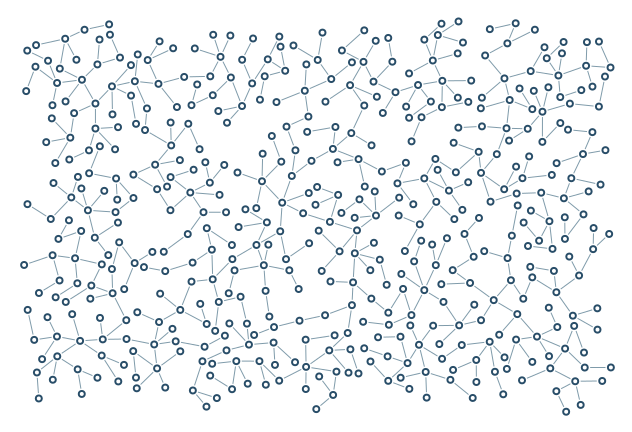

# Sprawling coverage

Balanced branching across a rectangular canvas with bounded reseeding.

```console
python -m examples.sprawl.example
python -m scripts.generate_examples sprawl --seed 19 --nodes 120
```

The default uses seed 7 and the Porcelain palette. The library recipe is defined in `src/samples.py`; the Python entry point calls that same factory so CLI and Python results stay consistent. Edit the returned graph before building to explore settings.

- `coverage.tile_size`: Size of coverage cells used to find underfilled areas.
- `coverage.reseed_attempts`: Budget for starting new components in empty space.
- `failures_per_parent`: Accumulated failed attempts before retiring a parent node.

`output/figure.png` and `output/figure.svg` show the same geometry. `output/results.json` records the seed, requested/achieved nodes, edges, stop reason, validation and timing. Large country and panorama recipes can take several minutes; `--nodes 120` is a smoke check, not a representative final composition.

Limit: A node target is an upper goal, not a guarantee of complete packing.



[Example index](../README.md) | [User guide](../../docs/guide/index.html)
