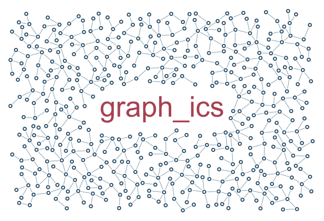

# Text with breathing room

Graph growth wraps around a measured text rectangle; padding scales with font size.

```console
python -m examples.typography.example
python -m scripts.generate_examples typography --seed 19 --nodes 120
```

The default uses seed 7 and the Porcelain palette. The library recipe is defined in `src/samples.py`; the Python entry point calls that same factory so CLI and Python results stay consistent. Edit the returned graph before building to explore settings.

- `Text.size`: Font size in world units; measured text excludes growth.
- `Text.padding_em`: Additional whitespace as a fraction of the font size.
- `Text.align`: Left, centre or right alignment around the text anchor.

`output/figure.png` and `output/figure.svg` show the same geometry. `output/results.json` records the seed, requested/achieved nodes, edges, stop reason, validation and timing. Large country and panorama recipes can take several minutes; `--nodes 120` is a smoke check, not a representative final composition.

Limit: The exclusion is a rectangle, not individual glyph outlines.



[Example index](../README.md) | [User guide](../../docs/guide/index.html)
