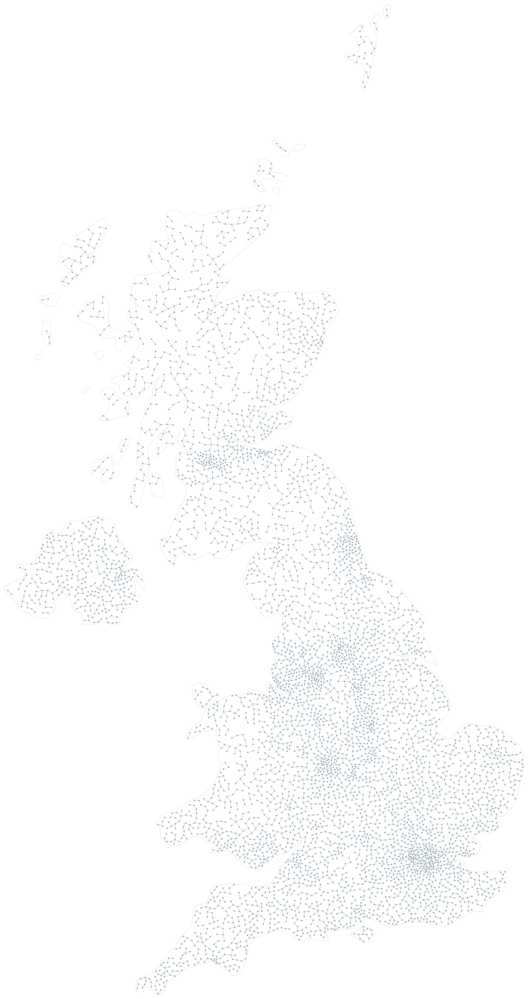

# UK / spacing only

The same population raster changes spacing while node dimensions stay fixed.

```console
python -m examples.uk_density_only.example
python -m scripts.generate_examples uk_density_only --seed 19 --nodes 120
```

The default uses seed 7 and the Porcelain palette. The library recipe is defined in `src/samples.py`; the Python entry point calls that same factory so CLI and Python results stay consistent. Edit the returned graph before building to explore settings.

- `SpatialFields.density`: Requested nodes per square world unit, converted to preferred spacing.

`output/figure.png` and `output/figure.svg` show the same geometry. `output/results.json` records the seed, requested/achieved nodes, edges, stop reason, validation and timing. Large country and panorama recipes can take several minutes; `--nodes 120` is a smoke check, not a representative final composition.

Limit: Population is mapped logarithmically; dots are not individual people.



[Example index](../README.md) | [User guide](../../docs/guide/index.html)
