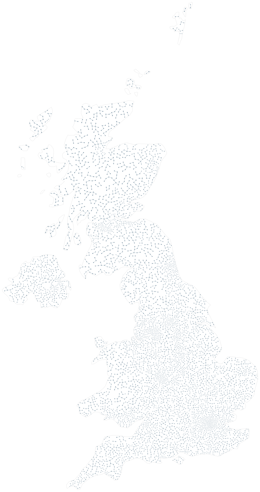

# United Kingdom / population density

WorldPop 2020 population density guides spacing and scale inside a Natural Earth UK boundary.

```console
python -m examples.uk_population.example
python -m scripts.generate_examples uk_population --seed 19 --nodes 120
```

The default uses seed 7 and the Porcelain palette. The library recipe is defined in `src/samples.py`; the Python entry point calls that same factory so CLI and Python results stay consistent. Edit the returned graph before building to explore settings.

- `log density mapping`: Compress population density logarithmically for readable spacing.
- `variable scale`: Shrink geometry in dense areas to retain city detail.
- `12000 target nodes`: Request a large map; the actual count is reported after packing.

`output/figure.png` and `output/figure.svg` show the same geometry. `output/results.json` records the seed, requested/achieved nodes, edges, stop reason, validation and timing. Large country and panorama recipes can take several minutes; `--nodes 120` is a smoke check, not a representative final composition.

Limit: Artistic logarithmic mapping, not one dot per person. Small islands and narrow coasts can remain empty.



[Example index](../README.md) | [User guide](../../docs/guide/index.html)
